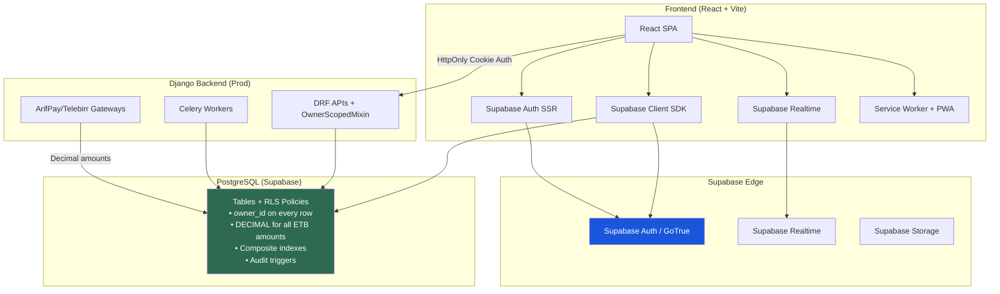

# AD-PRMS Strategic Fix Plan
> **92 issues → 7 workstreams → 4 sprints**  
> Includes: **Firebase → Supabase migration** as the architectural backbone that resolves ~25 issues at once

---

## Architecture Decision: Firebase → Supabase

> [!IMPORTANT]
> Migrating from Firebase to Supabase is not just a preference — it **structurally resolves 25+ issues simultaneously** because Supabase provides native PostgreSQL RLS, server-managed auth with HttpOnly cookies, real-time via Postgres channels, and proper storage policies. This one decision is the highest-leverage change in the entire plan.

### Why Supabase Over Firebase for AD-PRMS

```mermaid
flowchart LR
    subgraph Firebase["🔥 Firebase (Current)"]
        F1["Firestore NoSQL\n❌ No joins, no ACID transactions"]
        F2["Client-side security rules\n❌ Backdoor email, billable get() costs"]
        F3["Firebase Auth\n❌ JWT in localStorage"]
        F4["No server-side RLS\n❌ Client queries unscoped"]
        F5["Real-time via onSnapshot\n❌ No unsubscribe cleanup"]
    end

    subgraph Supabase["⚡ Supabase (Target)"]
        S1["PostgreSQL\n✅ ACID, joins, DecimalField, triggers"]
        S2["Row-Level Security\n✅ Native RLS per owner_id"]
        S3["Supabase Auth + GoTrue\n✅ HttpOnly cookies, MFA, OTP"]
        S4["Server-enforced scoping\n✅ Every query scoped by RLS"]
        S5["Realtime via Postgres\n✅ Channel-based, auth-gated"]
    end

    Firebase -->|"Migration"| Supabase
```



### Issues Resolved by Migration

| Issue ID | Issue | How Supabase Resolves It |
|---|---|---|
| Ph1-C1 | Hardcoded admin email backdoor in Firestore rules | **Eliminated** — Supabase uses PostgreSQL RLS policies, no rules file |
| Ph1-M1 | `isAdmin()` missing from subcollection list rules | **Eliminated** — RLS policies on the `audit_events` table |
| Ph1-M2 | Redundant billable `get()` calls on audit writes | **Eliminated** — no per-read billing; SQL JOINs replace cross-doc lookups |
| Ph1-M3 | `hasOnly()` schema too strict in Firestore | **Eliminated** — PostgreSQL schema is the source of truth |
| Ph1-M17 | Plaintext Firebase API key committed to repo | **Eliminated** — Supabase uses `SUPABASE_ANON_KEY` (safe to expose) + server-side `SERVICE_ROLE_KEY` |
| Ph1-M18 | Named Firestore DB but no `firebase.json` | **Eliminated** — no Firebase config needed |
| Ph3-C3 | Cross-tenant Firestore queries without owner scoping | **Resolved** — PostgreSQL RLS enforces `owner_id = auth.uid()` on every query |
| Ph3-C4 | JWT stored in `localStorage` | **Resolved** — Supabase Auth uses `HttpOnly; Secure; SameSite=Lax` cookies natively |
| Ph3-H3 | Missing Firestore offline persistence | **Resolved** — Supabase supports offline-first with `@supabase/realtime` + local cache |
| Ph3-H4 | Multi-document Firestore writes without transactions | **Resolved** — PostgreSQL `BEGIN; ... COMMIT;` transactions native |
| Ph3-H5 | Missing CSRF token on API requests | **Resolved** — cookie-based auth with Supabase handles CSRF via SameSite |
| Ph5-C2 | Client-side-only RBAC enforcement | **Resolved** — RLS + server-side `permission_classes` enforce all roles |
| Ph2-H3 | Views missing `OwnerScopedMixin` for RLS | **Simplified** — Supabase RLS is automatic per-table, not per-view |
| Ph2-H4 | WebSocket auth not enforced at handshake | **Resolved** — Supabase Realtime requires auth token to subscribe |

**Total: ~25 issues resolved or eliminated by the migration alone.**

### What Stays from Firebase

| Component | Decision |
|---|---|
| Firebase Auth | **Replace** with Supabase Auth (GoTrue) — built-in OTP, MFA, social login |
| Firestore | **Replace** with Supabase PostgreSQL — ACID transactions, RLS, `DECIMAL` |
| Firebase Hosting | **Already on Vercel** — no change |
| Firebase Cloud Messaging (FCM) | **Keep temporarily** for push notifications, then migrate to Supabase Edge Functions + web-push |

---

## Workstream Architecture

```mermaid
flowchart TD
    WS1["WS-1: Security Emergency\n🔴 Day 1-2\n15 critical + 8 high\nAll XSS, auth, rate-limit fixes"]
    WS2["WS-2: Supabase Migration\n🔴🟠 Sprint 1\nReplace Firebase entirely\n~25 issues auto-resolved"]
    WS3["WS-3: Financial Data Integrity\n🔴🟠 Sprint 1\nCents type, BigInt sums,\nDecimal gateways"]
    WS4["WS-4: Build & DX\n🟠🟡 Sprint 2\ntsconfig strict, ESLint,\npackage cleanup"]
    WS5["WS-5: Backend Hardening\n🟠🟡 Sprint 2\nDjango settings, Celery,\nDocker, nginx"]
    WS6["WS-6: UI/UX & A11y\n🟡🟢 Sprint 3\nForms, modals, mobile,\ncomponent refactors"]
    WS7["WS-7: Tests & CI/CD\n🟡🟢 Sprint 3\nCoverage gates, CI gates,\nmigration rollbacks"]

    WS1 --> WS2
    WS1 --> WS3
    WS2 --> WS4
    WS3 --> WS4
    WS4 --> WS5
    WS5 --> WS6
    WS5 --> WS7
```



---

## Sprint Plan

### Sprint 0: Security Emergency (Days 1–2)
> **Goal:** Stop active vulnerabilities. No architectural changes.

| # | Task | Issues Resolved | Files |
|---|---|---|---|
| 0.1 | Remove hardcoded admin email from `firestore.rules` | Ph1-C1 | `firestore.rules` |
| 0.2 | Add `express-rate-limit` to auth/OTP endpoints | Ph1-C4 | `server.ts` |
| 0.3 | Sanitize all `dangerouslySetInnerHTML` with DOMPurify | Ph4-C1 | `OromifaContractBuilder.tsx`, `RecordRetentionMatrix.tsx` |
| 0.4 | Sanitize export filenames | Ph3-C5 | `exportDownload.ts` |
| 0.5 | Add `RequireAuth` / `RequireRole` guards on all sensitive pages | Ph4-C2 | 4 page files |
| 0.6 | Remove `allowedHosts: true` from Vite dev config | Ph1-H6 | `server.ts` |
| 0.7 | Fix Vercel rewrites: exclude `/api/*` or document static-only | Ph1-C3 | `vercel.json`, `README.md` |
| 0.8 | Reduce JSON body limit to 2MB, add Express error handler | Ph1-M7, M9 | `server.ts` |
| 0.9 | Add TTL pruning to `seenWebhookReplayKeys` (LRU cache) | Ph1-H5 | `server.ts` |
| 0.10 | Add AbortController 10s timeout on all gateway fetch calls | Ph3-H2 | `arifpayGatewayService.ts`, `telebirrGatewayService.ts` |
| 0.11 | Add division-by-zero guards in `computeOwnerStatement` | Ph3-H1 | `accountingEngine.ts` |
| 0.12 | Add `Content-Security-Policy` header | Ph1-M6, M15 | `vercel.json`, `index.html` |

**Deliverable:** All 🔴 security issues neutralised. PR merged. Deploy.

---

### Sprint 1: Supabase Migration + Financial Integrity (Weeks 1–2)

#### WS-2: Firebase → Supabase Migration

| # | Task | Issues Resolved | Detail |
|---|---|---|---|
| 1.1 | **Set up Supabase project** | — | Create project, configure PostgreSQL, enable RLS globally |
| 1.2 | **Design PostgreSQL schema** | Ph1-M1,M2,M3 | Translate Firestore collections to tables: `users`, `workspaces`, `audit_events`, `period_closures`, `admins`. Add `owner_id UUID REFERENCES auth.users(id)` to every tenant-scoped table. Add proper indexes |
| 1.3 | **Write RLS policies** | Ph1-C1, Ph3-C3, Ph2-H3, Ph5-C2 | For every table: `CREATE POLICY owner_isolation ON table USING (owner_id = auth.uid())`. Admin policies via `auth.jwt() ->> 'role' = 'admin'`. **No hardcoded emails.** |
| 1.4 | **Replace Firebase Auth → Supabase Auth** | Ph3-C4 | Remove `firebase.ts`, `firebase-applet-config.json`, `firebase-blueprint.json`. Use `@supabase/ssr` for cookie-based auth (HttpOnly, Secure, SameSite=Lax). Remove all `localStorage` JWT code from `productionApiClient.ts`. Add OTP rate limiting via Supabase Auth hooks |
| 1.5 | **Rewrite `firebaseWorkspaceService.ts` → `supabaseWorkspaceService.ts`** | Ph3-C3, Ph3-H3, Ph3-H4 | Replace Firestore calls with Supabase client `.from('workspaces').select()`. Multi-row writes use `supabase.rpc()` or transactions. Offline support via Supabase cache |
| 1.6 | **Replace Firestore real-time → Supabase Realtime** | Ph2-H4, Ph3-H6 | Use `supabase.channel('ledger-updates').on('postgres_changes', ...)`. Auth is enforced at subscription. Reconnection with exponential backoff built in |
| 1.7 | **Replace Firebase Storage → Supabase Storage** | — | Document uploads via `supabase.storage.from('documents').upload()`. Storage policies enforce `owner_id` scoping. File type/size validation server-side |
| 1.8 | **Delete all Firebase files** | Ph1-M17, M18 | Remove: `firestore.rules`, `firebase-applet-config.json`, `firebase-blueprint.json`, `src/lib/firebase.ts`, `@firebase/*` dependencies. Remove `@firebase/eslint-plugin-security-rules` from ESLint config |
| 1.9 | **Update ESLint** to remove Firebase rules plugin | Ph1-H7 | ESLint now gets `typescript-eslint` + `react-hooks` (see WS-4) |
| 1.10 | **Migrate push notifications** | Ph3-H8 | Replace FCM with Supabase Edge Functions + `web-push` library. Revoke push subscriptions on logout |

#### WS-3: Financial Data Integrity

| # | Task | Issues Resolved | Detail |
|---|---|---|---|
| 1.11 | **Introduce `Cents` branded type** | Ph5-C1, Ph4-C3 | `export type Cents = number & { readonly __brand: unique symbol }`. Update all ~30 monetary fields in `prms.ts` |
| 1.12 | **Refactor `accountingEngine.ts` to BigInt** | Ph3-C1 | Replace all `number` aggregations with `BigInt` for subledger totals. Keep `toCents()` as the entry point |
| 1.13 | **Replace `float` with `Decimal` in Django gateways** | Ph2-H2 | `amount_etb: float` → `amount_etb: Decimal` in `gateways/clients.py`. Use `Decimal('0.01').quantize()` |
| 1.14 | **Server-side payment idempotency** | Ph3-C2 | Add `UNIQUE(idempotency_key)` constraint on payments table in Supabase. Enforce before gateway call |
| 1.15 | **Sign QR payloads with HMAC-SHA256** | Ph3-H7 | Server generates HMAC signature + expiry timestamp. Client encodes into QR. Server verifies on scan |
| 1.16 | **Add `formatCurrency()` to all ETB renders** | Ph4-C3 | Audit every `{amount}` in JSX. Replace with `{formatCurrency(amount, 'ETB')}` |
| 1.17 | **Convert seed data to integer cents** | Ph5-M2 | All `18000` → `1800000` (cents) in `seedData.ts`, `extendedSeedData.ts` |

**Deliverable:** Firebase completely removed. Supabase provides auth, database, real-time, storage. All financial values use `Cents`/`Decimal`. PR merged. Deploy.

---

### Sprint 2: Build/DX + Backend Hardening (Weeks 3–4)

#### WS-4: Build & Developer Experience

| # | Task | Issues Resolved |
|---|---|---|
| 2.1 | Enable `"strict": true` in `tsconfig.json`, fix all type errors | Ph1-H3 |
| 2.2 | Add `"node"`, `"vitest/globals"` to `tsconfig.types` | Ph1-H4 |
| 2.3 | Add `"include": ["src", "server", "tests"]` to tsconfig | Ph1-M12 |
| 2.4 | Configure `typescript-eslint` + `eslint-plugin-react-hooks` | Ph1-H7 |
| 2.5 | Fix `"lint"` script: `"tsc --noEmit && eslint ."` | Ph1-H7 |
| 2.6 | Fix `"start"` script: build `server.ts` → `dist/server.js` with esbuild | Ph1-H1 |
| 2.7 | Delete `bun.lock` (standardise on npm) | Ph1-H2 |
| 2.8 | Remove `legacy-peer-deps=true` from `.npmrc`, fix peer deps | Ph1-H9 |
| 2.9 | Move 7+ dev packages from `dependencies` to `devDependencies` | Ph1-M10 |
| 2.10 | Replace `rm -rf` clean script with `rimraf` | Ph1-M11 |
| 2.11 | Fix Playwright config: use `env` block, remove hardcoded paths | Ph1-C2, M4 |
| 2.12 | Add mobile browser projects to Playwright | Ph1-M5 |
| 2.13 | Populate `.env.example` with all variables + docs | Ph1-H8 |
| 2.14 | Fix `.gitignore`: add `*.db`, `*.pem`, `.vscode/`, `Thumbs.db` | Ph1-L3 |
| 2.15 | Fix `metadata.json`: remove name stutter, add frame permissions | Ph1-L2 |
| 2.16 | Add `favicon.ico`, sourcemaps, static caching | Ph1-L1, L5, M8 |
| 2.17 | Self-host Google Fonts for offline PWA | Ph1-M16 |
| 2.18 | Pin vitest version, document test runner usage | Ph6-L2.5 |
| 2.19 | Gate training data behind `import.meta.env.DEV` | Ph5-H4 |

#### WS-5: Backend Hardening (Django/Docker)

| # | Task | Issues Resolved |
|---|---|---|
| 2.20 | Remove `SECRET_KEY` fallback, raise `ImproperlyConfigured` | Ph2-H1 |
| 2.21 | Add startup guard on `DEBUG + ALLOWED_HOSTS['*']` | Ph2-C1 |
| 2.22 | Raise `ImproperlyConfigured` if `FIELD_ENCRYPTION_KEY` unset | Ph2-M1 |
| 2.23 | Audit all `APIView` subclasses for `OwnerScopedMixin` | Ph2-H3 |
| 2.24 | Add composite DB indexes on `LeaseAccountingSchedule` | Ph2-M2 |
| 2.25 | Add `bind=True, max_retries=3` to all Celery tasks + `atomic()` | Ph2-M3 |
| 2.26 | Add Docker resource limits to `docker-compose.prod.yml` | Ph2-M4 |
| 2.27 | Fix backup script: passphrase via fd, not CLI arg | Ph2-M5 |
| 2.28 | Audit Django templates for CSRF tokens | Ph2-L1 |
| 2.29 | Add server-side RBAC `permission_classes` mirroring frontend RBAC | Ph5-C2, Ph4-C2 |
| 2.30 | Mask MSISDN in all logs and audit trails | Ph3-M2, M3 |
| 2.31 | Sanitize server error responses before sending to client | Ph3-M5 |

**Deliverable:** Strict TypeScript compiles. ESLint catches React bugs. Django hardened. Docker resource-safe.

---

### Sprint 3: UI/UX + Tests + Polish (Weeks 5–6)

#### WS-6: UI/UX & Accessibility

| # | Task | Issues Resolved |
|---|---|---|
| 3.1 | Add `min="0.01" max="9999999.99" step="0.01"` on all financial inputs | Ph4-H1 |
| 3.2 | Add typed confirmation modals for destructive actions | Ph4-H2 |
| 3.3 | Add file type/size validation on uploads | Ph4-H3 |
| 3.4 | Fix `autoComplete` on OTP/PIN/password fields | Ph4-H4 |
| 3.5 | Add `aria-label` to all icon buttons + focus traps on modals | Ph4-M2 |
| 3.6 | Enforce 44×44px mobile touch targets | Ph4-M3 |
| 3.7 | PWA install button: check standalone mode | Ph4-M3 |
| 3.8 | Memoize D3/Recharts data with `useMemo` | Ph4-M1 |
| 3.9 | Add `react-window` virtualisation on large lists | Ph4-M1 |
| 3.10 | Memoize `PrmsContext` value with `useMemo` | Ph5-H1 |
| 3.11 | Persist locale/dateMode to `localStorage` | Ph5-H2 |
| 3.12 | Handle service worker `onNeedRefresh` with update banner | Ph5-H3 |
| 3.13 | Add localized error boundaries on Finance, Tax, Approvals routes | Ph5-M3 |
| 3.14 | Fix `useEffect` cleanup on timers/camera | Ph4-L2 |
| 3.15 | Refactor `FinanceLedgerTabs` (1500 ln → ~4 files) | Ph4-L1 |
| 3.16 | Refactor `TenantMobileApp` (2000 ln → ~5 files) | Ph4-L1 |
| 3.17 | Refactor `OromifaContractBuilder` (1200 ln → ~3 files) | Ph4-L1 |
| 3.18 | Add Zod/ajv runtime validation on WebSocket messages | Ph3-M4 |
| 3.19 | Add SMS dispatch debounce (5s cooldown) | Ph3-M3 |
| 3.20 | Add reminder deduplication | Ph3-M7 |
| 3.21 | Validate Ethiopic calendar availability explicitly | Ph3-M6 |
| 3.22 | Validate account codes before journal posting | Ph3-M1 |
| 3.23 | Freeze RBAC role constants, add runtime validation | Ph5-L1 |
| 3.24 | Add typed `ApprovalPayload` discriminated union | Ph5-M1 |

#### WS-7: Tests & CI/CD

| # | Task | Issues Resolved |
|---|---|---|
| 3.25 | Add `needs: [ci]` gate on `deploy-vercel.yml` | Ph6-H1 |
| 3.26 | Add `npm audit` + `pip-audit` to CI pipeline | Ph6-H1 |
| 3.27 | Mask DB credentials in CI logs via `::add-mask::` | Ph6-M1 |
| 3.28 | Add Vitest coverage thresholds (80% lines/functions/branches) | Ph1-M13 |
| 3.29 | Use `@vitest-environment node` for backend/crypto tests | Ph1-M14 |
| 3.30 | Add boundary/negative tests to `accountingEngine.test.ts` | Ph6-H2 |
| 3.31 | Add msw gateway tests: timeout, bad HMAC, malformed JSON | Ph6-M4 |
| 3.32 | Add migration `reverse_code` handlers on all custom SQL | Ph6-M3 |
| 3.33 | Make RLS migration SQL idempotent with schema qualifiers | Ph6-M2 |
| 3.34 | Add `docs/RUNBOOK.md` for production incidents | Ph6-L1 |
| 3.35 | Fix `check-health.sh`: `set -euo pipefail`, env-driven ports | Ph6-L2 |
| 3.36 | Fix README: correct port, document Vercel limitations | Ph1-M19 |
| 3.37 | Sanitise `/api/health` response (remove `bindHost`) | Ph1-L4 |

**Deliverable:** Full accessibility. 80%+ coverage. CI gates prevent bad deploys. Production runbook.

---

## New Architecture After Plan Completion



---

## Effort Estimates

| Sprint | Duration | Team Size | Issues Resolved |
|---|---|---|---|
| **Sprint 0** (Security Emergency) | 2 days | 1–2 devs | 12 tasks → ~20 issues |
| **Sprint 1** (Supabase + Finance) | 2 weeks | 2–3 devs | 17 tasks → ~40 issues |
| **Sprint 2** (Build + Backend) | 2 weeks | 2 devs | 31 tasks → ~35 issues |
| **Sprint 3** (UI/UX + Tests) | 2 weeks | 2 devs | 37 tasks → ~30 issues |
| **Total** | **~6 weeks** | **2–3 devs** | **92 issues → 0** |

> [!TIP]
> **Sprint 0 should be done TODAY** — the hardcoded email backdoor, missing rate limiting, and `localStorage` JWT are actively exploitable vulnerabilities. Everything in Sprint 0 is a surgical fix that doesn't require the Supabase migration.

---

## Key Dependencies & Risks

| Risk | Mitigation |
|---|---|
| Supabase free tier limits (500MB DB, 1GB storage) | AD-PRMS is a training prototype — well within limits. Scale to Pro (\$25/mo) for production |
| Data migration from Firestore → PostgreSQL | Write a one-time migration script. Training data is seed-generated, not accumulated |
| Breaking changes from `strict: true` in TypeScript | Budget 1–2 days for type error fixes. Prioritise financial type paths first |
| `Cents` branded type requires touching every component | Do it in Sprint 1 alongside Supabase. Use `find-and-replace` + compiler errors as guide |
| Team unfamiliar with Supabase | Supabase docs are excellent. RLS policies mirror existing Django `OwnerScopedMixin` concepts |

---

## Files to Delete After Migration

```
DELETE:
  firestore.rules                      ← Firestore security rules (replaced by RLS)
  firebase-applet-config.json          ← Firebase client config
  firebase-blueprint.json              ← Firebase project config
  src/lib/firebase.ts                  ← Firebase SDK init
  src/services/firebaseWorkspaceService.ts  ← Firestore CRUD
  bun.lock                             ← Duplicate lockfile

NEW FILES:
  src/lib/supabase.ts                  ← Supabase client init
  src/services/supabaseWorkspaceService.ts  ← Supabase CRUD
  src/services/supabaseAuthService.ts  ← Auth with HttpOnly cookies
  supabase/migrations/                 ← SQL migration files
  supabase/config.toml                 ← Supabase project config
  docs/RUNBOOK.md                      ← Production incident runbook
```
